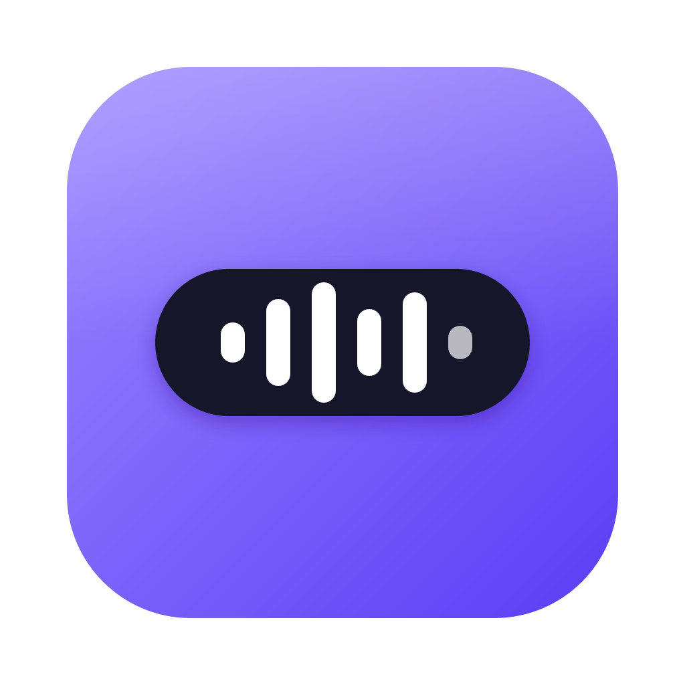

<p align="center"></p>

# YapTap

**Free, open-source dictation that runs entirely on your computer.** Hold a key, talk, let go: clean text appears wherever your cursor is. No cloud, no account, no word limits.

> **Status:** early prototype (v0.1.0). Developed on macOS (Apple Silicon). Windows and Linux builds come from the same code but haven't been tested on real machines yet. Bug reports welcome.

## Highlights
- **Hold or tap:** hold the key to talk, or tap it once to talk hands-free and tap again to finish. Esc cancels.
- **Works in any app:** text is pasted at the cursor and your clipboard is put back afterwards. Typing mode for apps that block paste.
- **Fast and accurate, offline:** NVIDIA Parakeet v3 (25 European languages, including English and German) or OpenAI Whisper (99 languages), running on your GPU via [transcribe.cpp](https://github.com/handy-computer/transcribe.cpp).
- **A calm little pill:** a floating bar with live voice levels shows when YapTap is listening, then gets out of the way.
- **Your words:** a dictionary for names and jargon, "heard → write" replacements, and "new line" / "new paragraph" voice commands.
- **History:** searchable, with what the model heard next to what was inserted. Keep it forever, 7 days, 24 hours or never.
- **Private by design:** audio is never saved or sent anywhere. The only network request is the one-time model download, and Offline mode blocks even that.

## Default shortcuts
| | |
|---|---|
| macOS | hold **fn** (set System Settings → Keyboard → "Press 🌐 key to" → **Do Nothing**) |
| Windows | hold **Ctrl + Win** |
| Linux | hold **Right Ctrl** |
| All | **Esc** cancels a recording · change the key in Settings → General |

## Quick start
```bash
pnpm install
pnpm app          # run in development (tray app; first run shows the setup)
pnpm check        # typecheck + clippy + unit tests
pnpm tauri build  # release build for this platform
```
You need Node 22+, pnpm, Rust and CMake (transcribe.cpp is compiled from source on the first build).

On macOS, dev builds get the microphone and Accessibility permissions through the terminal app you started them from.

### Command line
```bash
yaptap models                  # list models
yaptap download parakeet-v3    # download a model (checksum-verified)
yaptap transcribe note.wav     # print the transcript of a WAV file
yaptap --toggle                # start/stop dictation in the running app (handy on Wayland)
```

## Project layout
```
src/                    React UI (Vite): overlay pill + settings window
  styles/tokens.css     design tokens shared by every window
  components/           Pill bars, buttons, toggles, shortcut recorder, model card
  overlay/              the floating pill
  settings/             settings window, onboarding, panes
src-tauri/src/          Rust backend
  session.rs            one dictation: idle → listening → processing → done
  hotkeys.rs            global shortcut (handy-keys), hold vs tap
  recorder.rs           microphone capture (handy-recorder), live level
  engine.rs             speech recognition thread (transcribe.cpp) + VAD
  text.rs               text rules (voice commands, replacements), unit-tested
  insert.rs             paste / type into the focused app, clipboard restore
  models.rs             model catalog, checksum-verified downloads
  overlay.rs            non-activating pill window per platform
docs/RESEARCH.md        research, competitors, technical plan
```

## Credits
YapTap stands on the shoulders of [Handy](https://github.com/cjpais/Handy) (MIT): its `transcribe-cpp`, `handy-keys` and `handy-recorder` crates do the heavy lifting. Models: [Parakeet TDT 0.6B v3](https://huggingface.co/nvidia/parakeet-tdt-0.6b-v3) by NVIDIA (CC-BY-4.0), [Whisper](https://github.com/openai/whisper) by OpenAI (MIT), [Silero VAD](https://github.com/snakers4/silero-vad) (MIT), GGUF builds by the transcribe.cpp project.

## About
YapTap is made by **Fabian Builds** ([@fabianfreund](https://github.com/fabianfreund)) and is part of [Appetizer](https://github.com/fabianfreund/Appetizer-launcher), a collection of free, open-source utility apps.

**Built with AI.** Most of YapTap's code, design and docs were written with [Claude Code](https://claude.com/claude-code), steered and reviewed by a human. If you don't want to use or support software made with AI tools, that's a fair choice.

YapTap is not affiliated with Wispr Flow or any other dictation app.

## License
[MIT](LICENSE).
